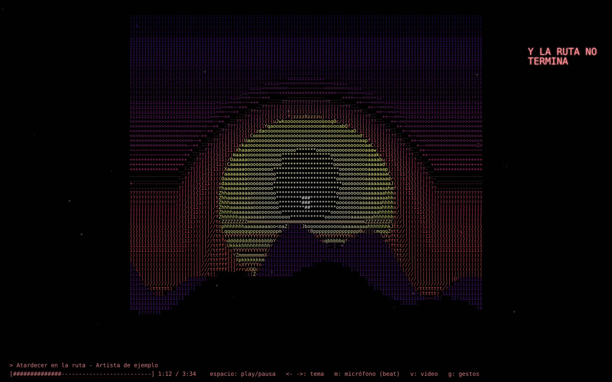

# ascii-now-playing

Visualizador ASCII de lo que suena en Spotify. La tapa del disco se redibuja con caracteres de colores, con la letra sincronizada en los márgenes, dibujitos al ritmo del beat, y se puede manejar con la mano. Todo vive en un solo `index.html`, sin build.



*La portada de la captura es una ilustración de ejemplo.*

## Qué hace

- **Tapa en ASCII:** crece de abajo hacia arriba cada vez que cambia el tema.
- **Letra sincronizada** (de [LRCLIB](https://lrclib.net)), con el color de la tapa y alineada a la grilla del arte.
- **Beat por micrófono** (`m`): escucha los graves de lo que suena por los parlantes y dispara dibujitos.
- **Video** (`v`): captura una pestaña (un videoclip en YouTube, por ejemplo) y la convierte a ASCII en vivo.
- **Gestos con la cámara** (`g`): puño = pausa, mano abierta = play, señalar = siguiente, paz = anterior. Hay que sostener la pose 0,6 s. Usa [MediaPipe](https://ai.google.dev/edge/mediapipe) (se carga del CDN recién al activarlo) y es un port de [gesture-tracking](https://github.com/SebaAq/gesture-tracking).
- **Teclado:** `espacio` play/pausa, `←` `→` tema.

## Correr

1. En https://developer.spotify.com/dashboard creá una app (Web API) con redirect URI `http://127.0.0.1:8888/` (tiene que ser `127.0.0.1`, Spotify no acepta `localhost`).
2. Pegá tu Client ID en `CLIENT_ID` en `index.html`.
3. `python3 -m http.server 8888 --bind 127.0.0.1` y abrí http://127.0.0.1:8888/

Controlar la reproducción (pausa, siguiente, anterior) requiere Spotify Premium.

Sin Spotify: `http://127.0.0.1:8888/?img=<imagen>` renderiza esa imagen (tiene que ser del mismo origen o tener CORS).

## Chequeos

```bash
sed -n '/<script>/,/<\/script>/p' index.html | sed '1d;$d' > /tmp/s.js && node --check /tmp/s.js
node test-gestos.mjs   # clasificación de gestos con manos sintéticas, sin cámara
```

## Privacidad

Todo corre en tu navegador. El login usa PKCE (sin backend ni client secret) y los tokens quedan en `localStorage`. La cámara y el micrófono se procesan localmente y no se graban ni se envían.

## Licencia

[MIT](LICENSE)

Desarrollado con asistencia de [Claude Code](https://claude.com/claude-code).
